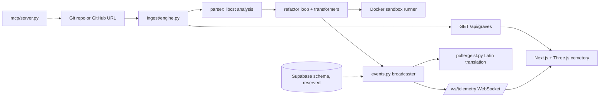

<div align="center">

# NecroCD 👻⚡
### Autonomous SRE Control Room & Git Graveyard Pipeline
*Built for Kiroween 2026*

[](https://fastapi.tiangolo.com/)
[](https://nextjs.org/)
[](https://supabase.com/)
[](https://threejs.org/)
[](https://kiro.dev/)

[Core Architecture](#-core-architecture) • [Kiro Integration](#%EF%B8%8F-kiro-integration) • [Getting Started](#-getting-started) • [Testing](#-testing) • [Release](#-release) • [Handover](docs/HANDOVER.md) • [License](#-license)

</div>

---

## 💀 Overview

**NecroCD** is an elite autonomous SRE control room and git graveyard pipeline that treats stale, abandoned repositories and corrupt branches as haunted graves. By combining advanced Abstract Syntax Tree (AST) analysis (`libcst`), secure Docker sandboxing, and an immersive Three.js gothic cemetery dashboard, NecroCD automatically diagnoses legacy code rot, performs surgical refactoring into modern FastAPI/Next.js services, and executes automated exorcisms on broken builds.

---

## 🏛️ Core Architecture

| Component | Technology | Description |
| :--- | :--- | :--- |
| **Backend Engine** | FastAPI, Python `libcst`, Docker | Async ingestion pipeline, AST parsing for legacy syntax rot, and isolated container execution. |
| **3D Cemetery Dashboard** | Next.js App Router, Three.js, Tailwind CSS | Real-time 3D interactive graveyard where branches are rendered as glowing gravestones. |
| **Telemetry & State** | Supabase (PostgreSQL), WebSockets | Tracks ghost telemetry, active exorcism logs, pull request resurrection metrics, and audit trails. |
| **Agentic Core** | Kiro AI, MCP Server, Specs (`/.kiro/`) | Design-first contracts, local model context protocol routing, and pre-commit automation hooks. |

---

## 🕯️ Key Features

* **Interactive 3D Cemetery Canvas:** Stale branches and abandoned PRs appear as 3D gravestones, glowing spectral blue if restable, or pulsing crimson red if corrupted by syntax rot.
* **Poltergeist Event Handler:** When tests fail or dependencies throw errors during refactoring, the UI triggers an immersive mutation: screen shake, phosphor green terminal bleeding into crimson red, and AI-generated Latin stack-trace translations.
* **Surgical AST Refactoring:** Uses Python's `libcst` to preserve code formatting while safely replacing deprecated imports (`urllib2`, old Queue modules) with modern asynchronous FastAPI routers.
* **Zero-Trust MCP Integration:** Local Model Context Protocol server enabling autonomous agents to safely inspect git refs and daemon logs.

---

## 📂 Project Structure

```text
NecroCD/
├── .env.example               # all environment variables
├── .kiro/
│   ├── hooks/                 # pre-commit, post-merge, exorcism hook
│   ├── settings/mcp.json
│   ├── specs/                 # 01-03 design contracts
│   └── steering/tech-stack.md
├── backend/
│   ├── main.py
│   ├── models.py  events.py  poltergeist.py
│   ├── ingest/  parser/  refactor/  sandbox/  routers/
│   ├── tests/
│   ├── requirements.txt       # pinned runtime deps
│   └── requirements-dev.txt   # + pytest, pytest-asyncio, httpx
├── frontend/
│   ├── app/                   # layout.tsx, page.tsx, globals.css
│   ├── components/            # CemeteryCanvas.tsx, PoltergeistOverlay.tsx
│   ├── lib/                   # useTelemetry.ts, types.ts
│   ├── package.json
│   └── package-lock.json
├── mcp/server.py
├── docs/HANDOVER.md
├── scripts/                   # install-hooks.sh, release-tag.sh
├── supabase/migrations/
├── render.yaml                # Render blueprint (backend + frontend)
└── README.md
```

---

## 🧭 Architecture



Dotted edges are not wired at runtime yet: the MCP server is used by Kiro, and the Supabase schema exists in `supabase/migrations/` but the backend does not read or write it yet.

---

## ⚙️ Kiro Integration

NecroCD uses Kiro for design-first engineering and agent automation:

* **Specs** (`.kiro/specs/`): AST transformation and event contracts written before the code.
* **MCP server** (`.kiro/settings/mcp.json`, `mcp/server.py`): stdio server giving the agent allowlisted git ref and Docker log tools, bounded by `NECROCD_ALLOWED_ROOTS`.
* **Hooks** (`.kiro/hooks/`): pre-commit scan for legacy code (blocks only when `NECROCD_STRICT=1` and a high severity finding exists) and a post-merge scan. Install with `scripts/install-hooks.sh`.
* **Steering** (`.kiro/steering/tech-stack.md`): the technology stack constraints.

---

## 🚀 Getting Started

**Prerequisites:** Python 3.11+, Node.js 18+ and npm. A running Docker daemon is only needed for sandboxed test execution (the dashboard works without it).

```bash
git clone https://github.com/brysyl/NecroCD.git
cd NecroCD
cp .env.example .env   # optional, defaults work locally
```

**Backend** (terminal 1):

```bash
cd backend
python -m venv .venv && source .venv/bin/activate
pip install -r requirements-dev.txt   # use requirements.txt for runtime only
uvicorn main:app --reload --port 8000
```

**Frontend** (terminal 2):

```bash
cd frontend
npm ci
npm run dev
```

Open <http://localhost:3000>. If the backend is unreachable the UI shows a `MOCK DATA` badge and falls back to mock graves, and the "Simulate Poltergeist" button triggers the effect locally.

### Judge quick-start

1. Start backend and frontend as above.
2. `curl http://localhost:8000/health`, then `curl http://localhost:8000/api/graves`.
3. Open the dashboard and click **Simulate Poltergeist**.

Full walkthrough: [docs/HANDOVER.md](docs/HANDOVER.md).

### Environment variables

See [`.env.example`](.env.example).

| Variable | Used by | Required | Purpose |
| :--- | :--- | :--- | :--- |
| `NEXT_PUBLIC_API_URL` | frontend | Yes for production builds (default `http://localhost:8000`) | Backend base URL, inlined at build time |
| `CORS_ORIGINS` | backend | No (default `http://localhost:3000`) | Allowed browser origins |
| `NECROCD_REPO` | backend | No (default: this checkout) | Repo listed by `/api/graves` |
| `NECROCD_ALLOWED_ROOTS` | MCP server | No (default: this checkout) | Path allowlist for MCP git tools |
| `NECROCD_STRICT` | pre-commit hook | No | `1` blocks commits on high severity findings |
| `SUPABASE_URL`, `SUPABASE_SERVICE_KEY` | none yet | No | Reserved for Supabase persistence; not read by any code today |

---

## 🧪 Testing

```bash
cd backend && pytest -q              # 18 tests
cd frontend && npx tsc --noEmit && npm run build
```

Backend tests cover the AST analyzer, transformers, ingestion, sandbox flags (with a mocked Docker client), the refactor loop, the REST and WebSocket API, the MCP server, hooks and static checks of the SQL schema and `render.yaml`. They do not run against a real Docker daemon or Postgres.

---

## 🏷 Release

After PR #1 is merged, `scripts/release-tag.sh` creates and pushes the annotated tag `v1.0.0-kiroween` on the PR's merge commit. By default it only reports; it changes nothing without `--execute`.

```bash
scripts/release-tag.sh --dry-run
scripts/release-tag.sh --execute
```

Deployment: `render.yaml` defines both services for Render. A live deploy has not been verified. See [docs/HANDOVER.md](docs/HANDOVER.md).

---

## 🛡️ License
Distributed under the MIT License. See LICENSE for more information.

<div align="center">
<p>✨ <em>Summoning clean code from the digital netherworld.</em> ✨</p>
</div>

