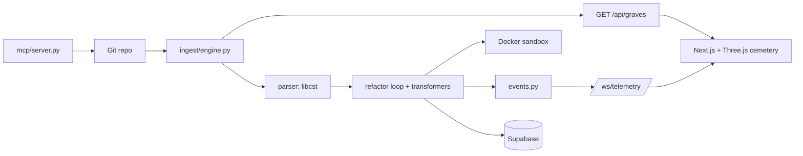

# NecroCD 👻⚡ – Autonomous SRE Control Room & Git Graveyard Pipeline

*Kiroween 2026 Hackathon submission.*

NecroCD treats stale branches and legacy code as haunted graves. It lists branches and their staleness, analyzes Python for legacy syntax rot, runs a refactor loop with an optional Docker sandbox, and streams telemetry to a 3D gothic cemetery dashboard. When a refactor fails, the UI triggers a "poltergeist" effect with a Latin translation of the stack trace.

More detail: [README.md](README.md) and [docs/HANDOVER.md](docs/HANDOVER.md).

## Architecture Overview



| Component | Technology | Location |
| :--- | :--- | :--- |
| Backend | FastAPI: REST endpoints (`/health`, `/api/graves`, `/api/telemetry`, `/api/exorcism`) and a `/ws/telemetry` WebSocket | `backend/main.py`, `backend/routers/` |
| AST parser | `libcst` analysis of legacy imports and syntax rot, format-preserving transformers (e.g. `urllib2`) | `backend/parser/`, `backend/refactor/` |
| 3D cemetery | Next.js 14, React Three Fiber / Three.js, Tailwind. Branches are gravestones (blue = restable, crimson = corrupted) | `frontend/` |
| Telemetry | Supabase (PostgreSQL) schema and client for telemetry, exorcism logs, metrics, audit trails. Skipped when `SUPABASE_URL` / `SUPABASE_SERVICE_KEY` are unset | `supabase/migrations/`, `backend/db/` |
| MCP server | stdio server with allowlisted git ref and Docker log tools, bounded by `NECROCD_ALLOWED_ROOTS`. Used by Kiro, not wired at runtime | `mcp/server.py`, `.kiro/settings/mcp.json` |
| Sandbox | Docker runner for test execution | `backend/sandbox/docker_runner.py` |
| Kiro assets | Specs, steering, hooks | `.kiro/` |

## Live Demo Instructions & Judge Walkthrough Guide

There is **no live deployment**. Run it locally. `render.yaml` defines a Render blueprint for the backend and frontend, but it has never been deployed.

Prerequisites: Python 3.11+, Node.js 18+. Docker is not needed for these steps.

1. **Backend** (terminal 1)

   ```bash
   cd backend
   python -m venv .venv && source .venv/bin/activate
   pip install -r requirements-dev.txt
   uvicorn main:app --port 8000
   ```

2. **Frontend** (terminal 2)

   ```bash
   cd frontend
   npm ci
   npm run dev
   ```

3. Open <http://localhost:3000>. You should see a moonlit cemetery with a gravestone per git branch and a header with SRE counters. If the backend is unreachable, a `MOCK DATA` badge appears and mock graves are shown.
4. Click **Simulate Poltergeist**. Expected: screen shake, the terminal overlay turning from phosphor green to crimson, and a Latin stack-trace translation.
5. Exercise the API:

   ```bash
   curl http://localhost:8000/health
   curl http://localhost:8000/api/graves
   curl -X POST http://localhost:8000/api/telemetry/poltergeist \
     -H 'content-type: application/json' \
     -d '{"trace":"ImportError: No module named urllib2"}'
   ```

   WebSocket at `ws://localhost:8000/ws/telemetry`. Interactive docs at <http://localhost:8000/docs>.
6. Run the tests:

   ```bash
   cd backend && pytest -q                       # 22 passed
   cd frontend && npx tsc --noEmit && npm run build
   ```

7. (Optional) Review the Kiro integration: `.kiro/specs/`, `.kiro/steering/`, `.kiro/hooks/` (install with `scripts/install-hooks.sh`), and `mcp/server.py`.

Without a Docker daemon, `/api/exorcism` cannot run its sandbox test stage and is expected to report a failed result.

## Team & Developer Attribution

Derived from the git history of this repository (owner: [brysyl](https://github.com/brysyl)):

| Contributor | Git identity |
| :--- | :--- |
| Bright Sylvester (repository owner, GitHub `brysyl`) | `Bright Sylvester <40733429+brysyl@users.noreply.github.com>`, `brysyl <sylvesterbright6@gmail.com>` |
| Kiro Agent (AI) | `Kiro Agent <244629292+kiro-agent@users.noreply.github.com>` |

This project was built with Kiro AI agents, using Kiro specs, steering, hooks and an MCP server. No other team members are claimed.

## Known limitations

* **Docker sandbox:** tests use a mocked Docker client. It has not been run against a real daemon.
* **Supabase:** persistence is wired but untested against a real database. The migration was never applied to a real Postgres instance.
* **3D visuals:** the Three.js scene and poltergeist effect have not been verified in a browser. The "expected" visuals come from the code.
* **No live deployment:** `render.yaml` is only statically checked.
* **Tests:** 22 backend tests pass, using mocks and static checks. There are no frontend unit tests. Some older text in README.md and docs/HANDOVER.md still says 18 tests.
* **MCP server:** used by Kiro only, not by the running app.
* **Security:** `npm audit` reported 2 findings (1 high, 1 critical) that were not fixed. No Python vulnerability scan was run.
* **Release:** PR #1 is not merged and the `v1.0.0-kiroween` tag has not been created.
