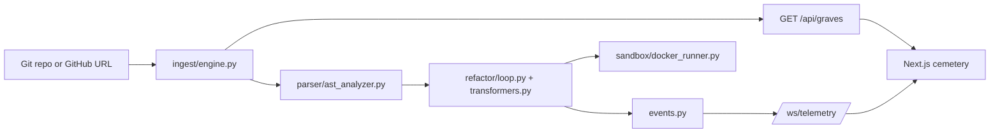

# NecroCD Handover (Kiroween release)

## 1. Executive summary

NecroCD treats stale branches and legacy code as "graves". A FastAPI backend lists branches and their staleness, analyzes Python with `libcst`, runs a refactor loop with an optional Docker sandbox, and streams telemetry over a WebSocket. A Next.js + React Three Fiber dashboard renders branches as gravestones and reacts to "poltergeist" failure events with a shake and a green to crimson mutation plus a Latin stack-trace translation.



| Area | Location |
| :--- | :--- |
| Backend API | `backend/main.py`, `backend/routers/` |
| AST analysis and transforms | `backend/parser/`, `backend/refactor/` |
| Docker sandbox | `backend/sandbox/docker_runner.py` |
| Telemetry and Latin translation | `backend/events.py`, `backend/poltergeist.py` |
| Dashboard | `frontend/app/page.tsx`, `frontend/components/`, `frontend/lib/` |
| MCP server | `mcp/server.py`, `.kiro/settings/mcp.json` |
| Hooks | `.kiro/hooks/`, `scripts/install-hooks.sh` |
| DB schema (not wired in) | `supabase/migrations/0001_necrocd_schema.sql` |
| Deploy blueprint | `render.yaml` |
| Release tagging | `scripts/release-tag.sh` |

## 2. Test suites (measured)

Run on this branch with Python 3.11.15: `cd backend && .venv/bin/pytest -q` gave **18 passed, 1 warning** (a Starlette deprecation notice about `httpx`).

| File | Tests | Covers |
| :--- | :--- | :--- |
| `backend/tests/test_all.py` | 11 | analyzer findings and syntax-rot handling, transformer idempotence and formatting preservation, router/component generators, Latin translation, URL validation, grave listing, sandbox flags and failure handling (Docker client mocked), refactor loop events, REST and WebSocket API |
| `backend/tests/test_mcp_hooks.py` | 7 | MCP tools and path allowlist, ref round trip and boundary escapes, MCP config, pre-commit hook output and strict mode, idempotent hook installer, static checks of the SQL schema and `render.yaml` |

Frontend: `npx tsc --noEmit` exited 0, and `npm ci --include=dev && npm run build` succeeded (static route `/`, 92.7 kB first load JS). There are no frontend unit tests.

## 3. Judge instructions

Prerequisites: Python 3.11+, Node 18+. Docker is not needed for these steps.

1. **Backend**

   ```bash
   cd backend
   python -m venv .venv && source .venv/bin/activate
   pip install -r requirements-dev.txt
   uvicorn main:app --port 8000
   ```

2. **Frontend** (new terminal)

   ```bash
   cd frontend
   npm ci
   npm run dev
   ```

3. Open <http://localhost:3000>.
   * Expected: a dark gothic scene with a moonlit cemetery, gravestones for each git branch (spectral blue when restable, crimson when corrupted), and a header with SRE counters showing the connection state.
   * If the backend is not running, a `MOCK DATA` badge appears and mock graves are shown.
4. Click **Simulate Poltergeist**. Expected: the screen shakes, the terminal overlay turns from phosphor green to crimson, and a Latin translation of a stack trace is shown. Dismiss it with the overlay control.
5. Try the API:

   ```bash
   curl http://localhost:8000/health
   curl http://localhost:8000/api/graves
   curl http://localhost:8000/api/telemetry
   curl -X POST http://localhost:8000/api/telemetry/poltergeist \
     -H 'content-type: application/json' \
     -d '{"trace":"ImportError: No module named urllib2"}'
   curl -X POST http://localhost:8000/api/exorcism \
     -H 'content-type: application/json' \
     -d '{"file":"m.py","source":"import urllib2\n"}'
   ```

   WebSocket: `/ws/telemetry` (for example `npx wscat -c ws://localhost:8000/ws/telemetry`). Interactive API docs: <http://localhost:8000/docs>.

   Without a Docker daemon, `/api/exorcism` cannot run its sandbox test stage and is expected to report a failed result rather than a successful one. This was not checked against a live daemon or called over HTTP in this audit.

Verified in this audit: the `/health`, `/api/graves` and `/api/telemetry/poltergeist` responses through FastAPI's test client (the graves response listed this repo's real branches; the poltergeist response contained a Latin translation). The browser visuals were not inspected, so the "expected" visuals above come from the code and earlier feature work.

## 4. Audit results

| Check | Result |
| :--- | :--- |
| Backend runtime dependencies | Pinned to the versions in the test venv (`backend/requirements.txt`); test tools split into `requirements-dev.txt` |
| Frontend dependencies | `package-lock.json` is tracked; `render.yaml` uses `npm ci --include=dev` so Tailwind and TypeScript types are present at build time |
| Environment variables | Documented in `.env.example` and the README table; `SUPABASE_URL` and `SUPABASE_SERVICE_KEY` are reserved and not read by any code |
| `npm audit` | 2 findings (1 high, 1 critical) on the current lockfile; the high one is PostCSS. Not fixed here because the suggested fix is a forced, possibly breaking upgrade. Review before public production use |
| Python vulnerability scan | Not run |
| Release script | `bash -n` passes; shellcheck is not installed here |

## 5. Release

`scripts/release-tag.sh` tags `v1.0.0-kiroween` on the merge commit of PR #1 after verifying through the REST API (`gh api repos/brysyl/NecroCD/pulls/1`) that it is merged. It changes nothing by default: `--dry-run` (or no flag) only reports, `--execute` tags and pushes. It refuses when the working tree is dirty, the tag exists locally or on `origin`, or the PR is not merged. Override the target with `--repo OWNER/NAME` and `--pr N`, or `NECROCD_GH_REPO` and `NECROCD_PR_NUMBER`.

## 6. Not verified

* **Docker sandbox execution:** tests use a mocked Docker client; no real container was run (no daemon available).
* **Supabase / Postgres:** the migration was never applied to a real database, and the backend does not use Supabase at runtime.
* **Live Render deploy:** `render.yaml` is only statically checked.
* **PR merge and tag:** PR #1 is not merged by this work and the tag was not created. The release script's success path (tag and push) was not exercised.
* **Browser rendering:** the 3D scene and poltergeist effect were not visually inspected in this audit.
* **Security scanning:** only `npm audit` was run.
